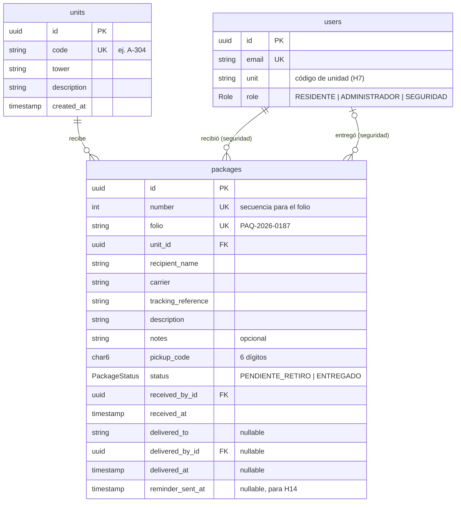
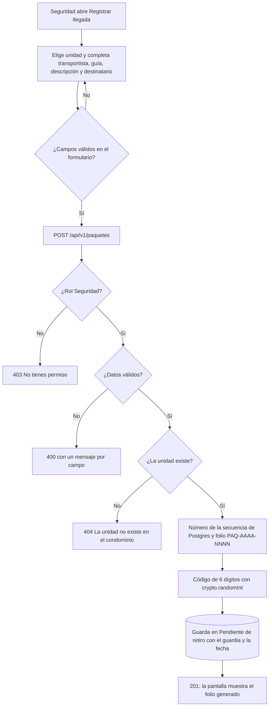
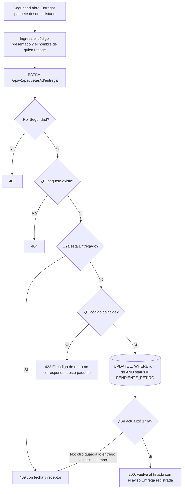
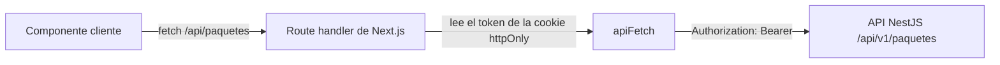

# Módulo 5: Paquetería

Responsable: Cristian Rodríguez · Historia implementada: **H13. Registrar la llegada y la entrega de paquetes** (IST-14).

Este documento describe el modelo de datos, los endpoints, los flujos, el estado en el frontend y las decisiones de arquitectura del módulo, con su justificación.

## Índice

1. [Alcance](#1-alcance)
2. [Modelo de datos](#2-modelo-de-datos)
3. [Endpoints](#3-endpoints)
4. [Flujos](#4-flujos)
5. [Frontend](#5-frontend)
6. [Decisiones de arquitectura](#6-decisiones-de-arquitectura)
7. [Pruebas](#7-pruebas)
8. [Datos de prueba](#8-datos-de-prueba)
9. [Pendientes y limitaciones conocidas](#9-pendientes-y-limitaciones-conocidas)

## 1. Alcance

El personal de seguridad registra la llegada de cada paquete a la caseta y, después, su entrega a una persona de la unidad destinataria. Un paquete solo se entrega si quien lo recoge presenta el **código de retiro de 6 dígitos** asignado al registrarlo, para que nunca se entregue a la persona equivocada.

| Task | Descripción | Estado |
| --- | --- | --- |
| DB-13.1 | Tabla de paquetes | Hecha |
| BE-13.1 | `POST /api/v1/paquetes` | Hecha |
| BE-13.2 | `PATCH /api/v1/paquetes/{id}/entrega` | Hecha |
| BE-13.3 | `GET /api/v1/paquetes` | Hecha |
| BE-13.4 | Pruebas de integración | Hecha |
| FE-13.1 | Formulario de registro | Hecha |
| FE-13.2 | Vista de paquetes pendientes | Hecha |
| FE-13.3 | Flujo de entrega | Hecha |
| QA-13.1 | Pruebas de aceptación | Ver [QA-13.1](qa/QA-13.1.md) |

Como base para el módulo se agregaron también los **roles de usuario** y la **tabla de unidades**, que no existían en el boilerplate y que otros módulos también necesitan.

## 2. Modelo de datos



Los modelos de Prisma están en inglés y las tablas en `snake_case` con `@map`, igual que el resto del boilerplate. Los nombres de la propuesta del análisis se traducen así:

| Análisis (`paquete`) | Prisma (`Package`) / tabla `packages` |
| --- | --- |
| `folio` | `folio` |
| `unidad_id` | `unitId` / `unit_id` |
| `destinatario` | `recipientName` |
| `empresa_mensajeria` | `carrier` |
| `descripcion` | `description` |
| `codigo_retiro` | `pickupCode` |
| `estado` | `status` (enum) |
| `recibido_por` | `receivedById` |
| `fecha_recepcion` | `receivedAt` |
| `entregado_a` | `deliveredTo` |
| `entregado_por` | `deliveredById` |
| `fecha_entrega` | `deliveredAt` |
| `fecha_recordatorio` | `reminderSentAt` |

Se agregaron `trackingReference` (referencia o guía) y `notes` (observaciones) porque el diseño de la pantalla de registro los pide.

### Reglas en la base de datos

| Regla | Cómo se implementa |
| --- | --- |
| Estado válido | Enum `PackageStatus` (equivale al `CHECK` de estado de DB-13.1) |
| Código de 6 dígitos | `CHECK (pickup_code ~ '^[0-9]{6}$')` |
| Un paquete "Entregado" tiene receptor, guardia y fecha; uno pendiente no | `CHECK` de consistencia entre `status` y los campos `delivered_*` |
| Folio único | Índice único sobre `folio` |
| El paquete no se pierde | Llaves foráneas con `ON DELETE RESTRICT`: no se puede borrar una unidad ni un usuario con paquetes |

Migraciones: `20261107204035_agrega_roles_y_unidades` y `20261107205048_crea_tabla_paquetes`.

## 3. Endpoints

Base: `/api/v1`. Todas las rutas requieren `Authorization: Bearer <token>`. La documentación interactiva está en `/api/docs` (Swagger).

| Método | Ruta | Rol | Respuestas |
| --- | --- | --- | --- |
| `GET` | `/unidades` | Seguridad, Administración | 200, 401, 403 |
| `GET` | `/paquetes` | Seguridad | 200, 400, 401, 403 |
| `GET` | `/paquetes/{id}` | Seguridad, Administración | 200, 400, 401, 403, 404 |
| `POST` | `/paquetes` | Seguridad | 201, 400, 401, 403, 404 |
| `PATCH` | `/paquetes/{id}/entrega` | Seguridad | 200, 400, 401, 403, 404, 409, 422 |

No existe ninguna ruta `DELETE`: los paquetes no se eliminan.

**Ninguna respuesta incluye el código de retiro.** Solo lo conocerá el residente, a través del aviso de H14.

### `POST /paquetes`: registrar llegada

```json
{
  "unitId": "uuid de la unidad",
  "recipientName": "Carlos Mendoza",
  "carrier": "Estafeta",
  "trackingReference": "EST-629483715",
  "description": "1 caja mediana de cartón, cerrada.",
  "notes": "Sin daños visibles en el empaque."
}
```

| Código | Cuándo |
| --- | --- |
| 201 | Paquete guardado en "Pendiente de retiro", con folio y código generados y el guardia como quien lo recibió |
| 400 | Falta un campo obligatorio, supera el largo máximo o se envía un campo no permitido (por ejemplo `pickupCode`). Devuelve un mensaje por campo |
| 403 | El usuario no es de Seguridad |
| 404 | "La unidad indicada no existe en el condominio." |

### `PATCH /paquetes/{id}/entrega`: registrar entrega

```json
{ "pickupCode": "482913", "deliveredTo": "Ana Martínez" }
```

| Código | Cuándo |
| --- | --- |
| 200 | El paquete pasa a "Entregado" con fecha, quién lo recogió y el guardia que lo entregó |
| 400 | El código no tiene 6 dígitos o falta el nombre de quien recoge |
| 403 | El usuario no es de Seguridad |
| 404 | El paquete no existe |
| 409 | El paquete ya fue entregado. Mensaje con la fecha y el receptor, además de los campos `deliveredAt` y `deliveredTo` |
| 422 | "El código de retiro no corresponde a este paquete." |

### `GET /paquetes`: listado para la caseta

| Parámetro | Descripción |
| --- | --- |
| `estado` | `PENDIENTE_RETIRO` (por defecto) o `ENTREGADO` |
| `unidad` | Código exacto de la unidad, sin distinguir mayúsculas |
| `folio` | Parte del folio |
| `empresa` | Transportista exacto, sin distinguir mayúsculas |
| `q` | Búsqueda general por folio, nombre del destinatario o código de unidad |
| `page` | Página (20 paquetes por página) |

La respuesta incluye `items`, `page`, `pageSize`, `total`, `totalPages`, `pendingCount` (total de pendientes), `pendingRecipientCount` (destinatarios distintos con pendientes) y `carriers` (transportistas registrados, para el filtro). Los pendientes se ordenan del más antiguo al más reciente.

## 4. Flujos

### Registro de llegada



### Entrega con código de retiro



## 5. Frontend

### Pantallas

| Ruta | Task | Contenido |
| --- | --- | --- |
| `/paquetes` | FE-13.2 | Contador de pendientes, búsqueda, filtro por transportista, tabla paginada y estados de carga, error (con reintento) y vacío |
| `/paquetes/nuevo` | FE-13.1 | Formulario con selector de unidades, resumen en vivo y confirmación con el folio generado |
| `/paquetes/{id}/entrega` | FE-13.3 | Datos del paquete, código de retiro y nombre de quien recoge; mensajes para 409 y 422; botón deshabilitado durante el envío |

Las pantallas usan el layout de `(dashboard)` del módulo de incidencias (H7). El `Sidebar` y el `Header` muestran el menú "Operación de caseta" al rol Seguridad, y para los demás roles se ven igual que antes. El layout de `/paquetes` revisa el rol en el servidor y muestra "No tienes acceso a esta sección" a cualquier otro rol.

### Comunicación con el backend



Se sigue el mismo patrón que incidencias: el navegador llama a rutas internas de Next (`app/api/paquetes/...`), que reenvían la petición al backend con el token guardado en la cookie `httpOnly`. **El token nunca queda accesible al JavaScript del navegador.**

### Estado en el frontend

No se agregó una librería de estado global (Zustand o Redux). Al momento de implementar H13 el equipo no había agregado ninguna, y este módulo no comparte estado entre pantallas:

- **Estado de cada pantalla:** `useState` (filtros, página, resultado de la carga).
- **Formularios:** `react-hook-form` con validación `zod`, las mismas librerías que usa el formulario de incidencias.
- **Datos entre pantallas:** se pasan por la URL. Por ejemplo, `/paquetes?entregado=PAQ-2026-0187` muestra el aviso de entrega registrada.
- **Estado de carga:** se deriva del estado, comparando la petición actual con la última respuesta, en vez de guardarse por separado. Así se cumple la regla `react-hooks/set-state-in-effect` del linter del proyecto.

Si el equipo adopta una librería de estado global, este módulo no necesita migrar: no tiene estado compartido.

## 6. Decisiones de arquitectura

### 6.1 Arquitectura en capas

Los módulos `paquetes` y `unidades` siguen las capas del boilerplate: `controllers → services → repositories → Prisma`.

- **Controlador:** rutas, roles y Swagger.
- **Servicio:** reglas de negocio (código, folio, estados y errores HTTP).
- **Repositorio:** el único lugar que usa Prisma.

**Justificación:** el servicio se prueba sin base de datos, con dobles del repositorio. Las reglas de negocio quedan separadas del ORM.

### 6.2 Roles con guard global y "todo abierto salvo lo marcado"

`RolesGuard` se registra como `APP_GUARD` después de `JwtAuthGuard` y solo actúa en las rutas con `@Roles(...)`.

**Justificación:** las rutas que ya existían (auth, incidencias) no cambian de comportamiento, y cada ruta nueva declara explícitamente quién la usa. El rol se lee del usuario que el guard de JWT relee de la base en cada petición, así que un cambio de rol aplica de inmediato. Un rol sin permiso recibe **403** (identificado pero sin permiso), no 401.

### 6.3 Roles y unidades sin romper el módulo de incidencias

- **`User.role`** tiene valor por defecto `RESIDENTE`: los usuarios existentes y el registro por `POST /users` siguen funcionando igual.
- **La tabla `units` es independiente.** `User.unit` (texto, de H7) no se convirtió en llave foránea, porque eso cambiaría el registro de usuarios. Unirlas queda como decisión del equipo.

### 6.4 Código de retiro de 6 dígitos guardado en texto

El residente necesita ver su código en el aviso (H14) y en el detalle del paquete (H15), así que el sistema tiene que poder leerlo. Guardarlo como hash, como las contraseñas, no lo protegería: con solo 1.000.000 de combinaciones se recupera en menos de un segundo.

La protección real está en otros puntos:
- Se genera con `crypto.randomInt`, que no es predecible.
- Nunca aparece en ninguna respuesta de la API.
- Solo Seguridad puede intentar una entrega, así que nadie de afuera puede probar códigos.
- Se compara en tiempo constante (`timingSafeEqual`).
- Deja de servir en cuanto el paquete se entrega.

### 6.5 Sin paso de "validar código" antes de confirmar

El diseño original tenía un botón "Validar código" separado de "Confirmar entrega". Un endpoint que solo responda si un código es correcto permitiría probar códigos sin dejar rastro de entregas. Por eso el código se valida **en la misma operación** que registra la entrega: si no coincide responde 422 y el paquete sigue pendiente.

### 6.6 Doble entrega imposible, incluso en simultáneo

La entrega es una actualización condicional: `UPDATE ... WHERE id = :id AND status = 'PENDIENTE_RETIRO'`. Si dos guardias confirman el mismo paquete a la vez, la base aplica solo una de las dos; la otra no actualiza ninguna fila y responde 409.

Hay una prueba de integración que lanza las dos entregas en paralelo y comprueba que el resultado es `[200, 409]`.

### 6.7 Folio a partir de una secuencia de Postgres

El número del folio sale de `nextval(...)`, que es atómico. Dos registros simultáneos nunca reciben el mismo folio; la prueba de integración registra 5 en paralelo.

**Consecuencia aceptada:** si un registro falla después de pedir el número, ese número se pierde y el folio salta. Lo importante es que no se repita, no que sea contiguo.

### 6.8 Los paquetes no se eliminan

No existe ruta `DELETE` y las llaves foráneas usan `RESTRICT`. El registro es la evidencia de que el paquete no se perdió.

### 6.9 Validación con un mensaje claro por campo

El decorador `@RequiredText` (en `src/common/decorators`, reutilizable por el equipo) recorta espacios y devuelve un solo mensaje en español por campo ("La empresa de mensajería es obligatoria.") en lugar de varios mensajes mezclados. `forbidNonWhitelisted` rechaza campos de más; por ejemplo, el cliente no puede enviar su propio `pickupCode`.

### 6.10 Pruebas contra una base separada

Las pruebas de integración usan `<base>_test`, que se crea y se migra sola antes de correrlas (`test/setup/global-setup.ts`). La base de desarrollo nunca se modifica.

La configuración de la app (prefijo `/api/v1` y `ValidationPipe`) se extrajo a `src/app.setup.ts`, para que `main.ts` y las pruebas levanten la aplicación exactamente igual.

## 7. Pruebas

```bash
npm test           # unitarias (17)
npm run test:e2e   # integración (23), requiere Postgres levantado
```

| Tipo | Archivo | Qué cubre |
| --- | --- | --- |
| Unitarias | `src/auth/guards/roles.guard.spec.ts` | Rutas sin `@Roles`, públicas, rol permitido, rol no permitido y sin usuario |
| Unitarias | `src/paquetes/services/paquetes.service.spec.ts` | Folio, código de 6 dígitos, unidad inexistente, entrega correcta, 422, 409, entrega simultánea, 404 y paginación |
| Integración | `test/paquetes.e2e-spec.ts` | Registro, folios en paralelo, unidad inexistente, campos obligatorios, entrega correcta, código incorrecto, doble entrega, entrega simultánea, ausencia de `DELETE`, detalle, listado, paginación y roles (403 y 401) |

Las pruebas de aceptación con los criterios de negocio están en [QA-13.1](qa/QA-13.1.md).

## 8. Datos de prueba

`npm run db:seed` crea las unidades A-19, A-20, A-202, A-304, B-103, B-205 y B-402, y estos usuarios (contraseña `Demo1234!`):

| Correo | Rol |
| --- | --- |
| `ricardo.soto@example.com` | Seguridad |
| `laura.admin@example.com` | Administración |
| `demo@example.com` | Residente (A-19) |
| `otro@example.com` | Residente (A-20) |

Si no hay paquetes, también crea cuatro pendientes con códigos conocidos e imprime en la terminal su folio y código, para poder probar la entrega.

## 9. Pendientes y limitaciones conocidas

| Tema | Detalle |
| --- | --- |
| `GET /paquetes/{id}` | Hoy es para Seguridad y Administración. BE-15.2 lo abrirá a los residentes de la unidad del paquete |
| `User.unit` y `units` | No están unidas por llave foránea; decisión pendiente del equipo junto con H7 |
| Personal sin unidad | Como `User.unit` es obligatorio en H7, los usuarios de Seguridad y Administración tienen `unit` vacío. Lo ideal sería hacerlo opcional |
| Búsqueda con tildes | La búsqueda no distingue mayúsculas pero sí tildes: "martinez" no encuentra "Martínez" |
| Destinatario | Se elige la unidad y se escribe el nombre; no hay búsqueda de residentes porque los usuarios no tienen nombre registrado |
| Avisos al residente | Corresponden a H14 y dependen de `NotificacionesService` del Módulo 9 |
