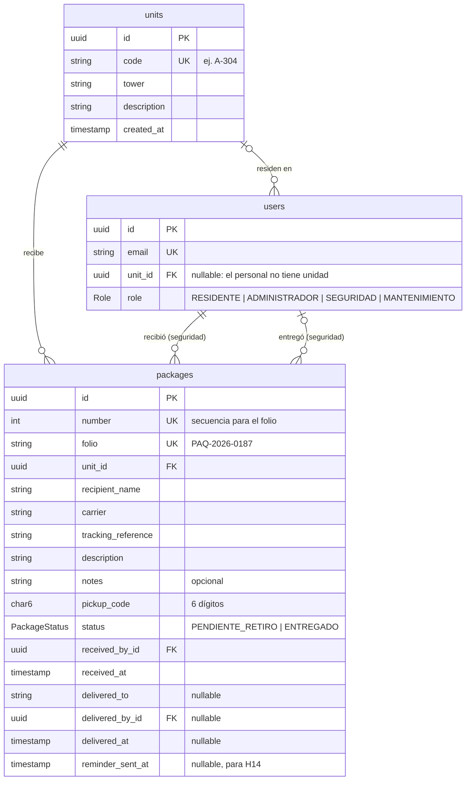
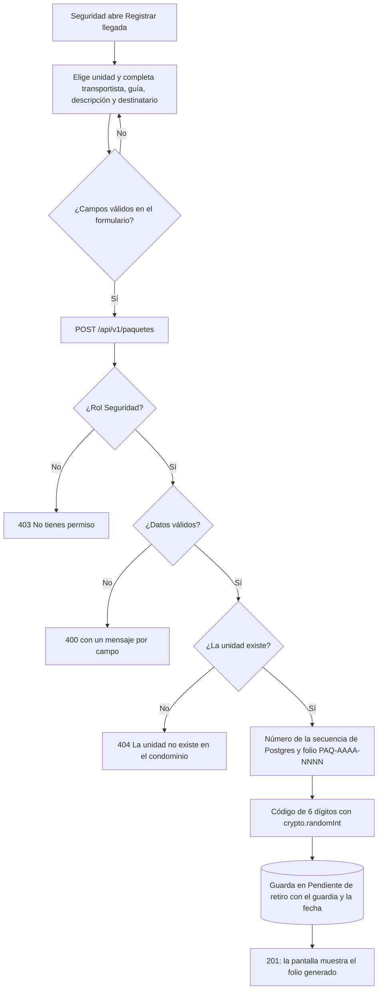
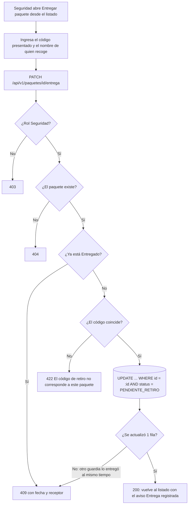
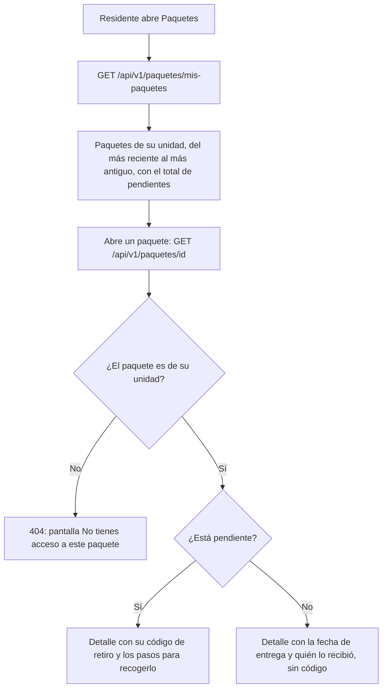
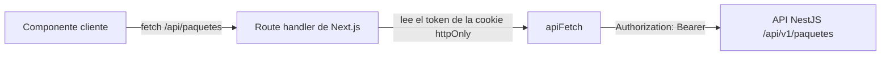
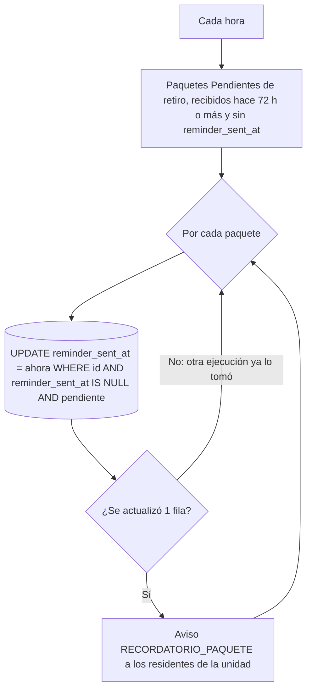

# Módulo 5: Paquetería

Responsable: Cristian Rodríguez · Historias implementadas: **H13. Registrar la llegada y la entrega de paquetes** (IST-14), **H14. Recibir aviso cuando llega un paquete** (sección 10) y **H15. Consultar mi historial de paquetes**.

Este documento describe el modelo de datos, los endpoints, los flujos, el estado en el frontend y las decisiones de arquitectura del módulo, con su justificación.

## Índice

1. [Alcance](#1-alcance)
2. [Modelo de datos](#2-modelo-de-datos)
3. [Endpoints](#3-endpoints)
4. [Flujos](#4-flujos)
5. [Frontend](#5-frontend)
6. [Decisiones de arquitectura](#6-decisiones-de-arquitectura)
7. [Pruebas](#7-pruebas)
8. [Datos de prueba](#8-datos-de-prueba)
9. [Pendientes y limitaciones conocidas](#9-pendientes-y-limitaciones-conocidas)

## 1. Alcance

El personal de seguridad registra la llegada de cada paquete a la caseta y, después, su entrega a una persona de la unidad destinataria. Un paquete solo se entrega si quien lo recoge presenta el **código de retiro de 6 dígitos** asignado al registrarlo, para que nunca se entregue a la persona equivocada. Los residentes consultan el historial de paquetes de su unidad y ven el código de los que siguen pendientes.

### H13

| Task | Descripción | Estado |
| --- | --- | --- |
| DB-13.1 | Tabla de paquetes | Hecha |
| BE-13.1 | `POST /api/v1/paquetes` | Hecha |
| BE-13.2 | `PATCH /api/v1/paquetes/{id}/entrega` | Hecha |
| BE-13.3 | `GET /api/v1/paquetes` | Hecha |
| BE-13.4 | Pruebas de integración | Hecha |
| FE-13.1 | Formulario de registro | Hecha |
| FE-13.2 | Vista de paquetes pendientes | Hecha |
| FE-13.3 | Flujo de entrega | Hecha |
| QA-13.1 | Pruebas de aceptación | Ver [QA-13.1](qa/QA-13.1.md) |

### H15

| Task | Descripción | Estado |
| --- | --- | --- |
| BE-15.1 | `GET /api/v1/paquetes/mis-paquetes` | Hecha |
| BE-15.2 | `GET /api/v1/paquetes/{id}` con acceso de residentes de la unidad | Hecha |
| BE-15.3 | Pruebas de integración | Hecha |
| FE-15.1 | Pantalla "Mis paquetes" | Hecha |
| QA-15.1 | Pruebas de aceptación | Ver [QA-15.1](qa/QA-15.1.md) |

H15 incluye además la **pantalla de detalle del paquete para el residente** (adelanto de FE-14.1 de H14), porque el criterio "un paquete de otra unidad no muestra su información al abrirlo" necesita una página de detalle.

Como base para el módulo se agregaron también los **roles de usuario** y la **tabla de unidades**, que no existían en el boilerplate y que otros módulos también necesitan.

## 2. Modelo de datos



Los modelos de Prisma están en inglés y las tablas en `snake_case` con `@map`, igual que el resto del boilerplate. Los nombres de la propuesta del análisis se traducen así:

| Análisis (`paquete`) | Prisma (`Package`) / tabla `packages` |
| --- | --- |
| `folio` | `folio` |
| `unidad_id` | `unitId` / `unit_id` |
| `destinatario` | `recipientName` |
| `empresa_mensajeria` | `carrier` |
| `descripcion` | `description` |
| `codigo_retiro` | `pickupCode` |
| `estado` | `status` (enum) |
| `recibido_por` | `receivedById` |
| `fecha_recepcion` | `receivedAt` |
| `entregado_a` | `deliveredTo` |
| `entregado_por` | `deliveredById` |
| `fecha_entrega` | `deliveredAt` |
| `fecha_recordatorio` | `reminderSentAt` |

Se agregaron `trackingReference` (referencia o guía) y `notes` (observaciones) porque el diseño de la pantalla de registro los pide.

### Reglas en la base de datos

| Regla | Cómo se implementa |
| --- | --- |
| Estado válido | Enum `PackageStatus` (equivale al `CHECK` de estado de DB-13.1) |
| Código de 6 dígitos | `CHECK (pickup_code ~ '^[0-9]{6}$')` |
| Un paquete "Entregado" tiene receptor, guardia y fecha; uno pendiente no | `CHECK` de consistencia entre `status` y los campos `delivered_*` |
| Folio único | Índice único sobre `folio` |
| El paquete no se pierde | Llaves foráneas con `ON DELETE RESTRICT`: no se puede borrar una unidad ni un usuario con paquetes |

Al integrar los módulos del equipo en `develop`, las migraciones se reorganizaron: el enum `Role` se crea en `20261108061054_areas_comunes`, las tablas `units` y `packages` en `20261109040915_h23_notificaciones`, y las dos reglas `CHECK` de paquetes en `20261109060000_paquetes_restricciones`. Después, el equipo convirtió `User.unit` en la llave foránea `unit_id` hacia `units`.

## 3. Endpoints

Base: `/api/v1`. Todas las rutas requieren `Authorization: Bearer <token>`. La documentación interactiva está en `/api/docs` (Swagger).

| Método | Ruta | Rol | Respuestas |
| --- | --- | --- | --- |
| `GET` | `/unidades` | Seguridad, Administración | 200, 401, 403 |
| `GET` | `/paquetes` | Seguridad | 200, 400, 401, 403 |
| `GET` | `/paquetes/mis-paquetes` | Residente | 200, 400, 401, 403 |
| `GET` | `/paquetes/{id}` | Seguridad, Administración, Residente (solo su unidad) | 200, 400, 401, 403, 404 |
| `POST` | `/paquetes` | Seguridad | 201, 400, 401, 403, 404 |
| `PATCH` | `/paquetes/{id}/entrega` | Seguridad | 200, 400, 401, 403, 404, 409, 422 |

No existe ninguna ruta `DELETE`: los paquetes no se eliminan.

**El código de retiro solo aparece en `GET /paquetes/{id}`, cuando lo consulta un residente de la unidad del paquete y el paquete sigue pendiente.** Ninguna otra respuesta lo incluye: ni los listados, ni el detalle para Seguridad o Administración, ni el detalle de un paquete ya entregado.

`mis-paquetes` se declara antes que `{id}` en el controlador; si no, Nest intentaría leer "mis-paquetes" como un id y respondería 400.

### `POST /paquetes`: registrar llegada

```json
{
  "unitId": "uuid de la unidad",
  "recipientName": "Carlos Mendoza",
  "carrier": "Estafeta",
  "trackingReference": "EST-629483715",
  "description": "1 caja mediana de cartón, cerrada.",
  "notes": "Sin daños visibles en el empaque."
}
```

| Código | Cuándo |
| --- | --- |
| 201 | Paquete guardado en "Pendiente de retiro", con folio y código generados y el guardia como quien lo recibió |
| 400 | Falta un campo obligatorio, supera el largo máximo o se envía un campo no permitido (por ejemplo `pickupCode`). Devuelve un mensaje por campo |
| 403 | El usuario no es de Seguridad |
| 404 | "La unidad indicada no existe en el condominio." |

### `PATCH /paquetes/{id}/entrega`: registrar entrega

```json
{ "pickupCode": "482913", "deliveredTo": "Ana Martínez" }
```

| Código | Cuándo |
| --- | --- |
| 200 | El paquete pasa a "Entregado" con fecha, quién lo recogió y el guardia que lo entregó |
| 400 | El código no tiene 6 dígitos o falta el nombre de quien recoge |
| 403 | El usuario no es de Seguridad |
| 404 | El paquete no existe |
| 409 | El paquete ya fue entregado. Mensaje con la fecha y el receptor, además de los campos `deliveredAt` y `deliveredTo` |
| 422 | "El código de retiro no corresponde a este paquete." |

### `GET /paquetes`: listado para la caseta

| Parámetro | Descripción |
| --- | --- |
| `estado` | `PENDIENTE_RETIRO` (por defecto) o `ENTREGADO` |
| `unidad` | Código exacto de la unidad, sin distinguir mayúsculas |
| `folio` | Parte del folio |
| `empresa` | Transportista exacto, sin distinguir mayúsculas |
| `q` | Búsqueda general por folio, nombre del destinatario o código de unidad |
| `page` | Página (20 paquetes por página) |

La respuesta incluye `items`, `page`, `pageSize`, `total`, `totalPages`, `pendingCount` (total de pendientes), `pendingRecipientCount` (destinatarios distintos con pendientes) y `carriers` (transportistas registrados, para el filtro). Los pendientes se ordenan del más antiguo al más reciente.

### `GET /paquetes/mis-paquetes`: historial del residente

| Parámetro | Descripción |
| --- | --- |
| `estado` | Opcional: `PENDIENTE_RETIRO` o `ENTREGADO`. Sin él se listan todos |
| `page` | Página (20 paquetes por página) |

Devuelve los paquetes de **la unidad del residente autenticado**, del más reciente al más antiguo: `items`, `page`, `pageSize`, `total`, `totalPages` y `pendingCount` (pendientes de su unidad, sin importar el filtro). Los entregados incluyen `deliveredAt` y `deliveredTo`. Todos los residentes de una misma unidad ven el mismo historial.

### `GET /paquetes/{id}`: detalle

| Quién consulta | Respuesta |
| --- | --- |
| Seguridad o Administración | 200 con el paquete, sin código de retiro |
| Residente de la unidad del paquete | 200, con `pickupCode` mientras está pendiente |
| Residente de otra unidad | **404** "El paquete no existe." |

## 4. Flujos

### Registro de llegada



### Entrega con código de retiro



### Consulta del residente



## 5. Frontend

### Pantallas

| Ruta | Rol | Task | Contenido |
| --- | --- | --- | --- |
| `/paquetes` | Seguridad | FE-13.2 | Contador de pendientes, búsqueda, filtro por transportista, tabla paginada y estados de carga, error (con reintento) y vacío |
| `/paquetes` | Residente | FE-15.1 | "Mis paquetes": pestañas Todos / Pendiente de retiro / Entregado, contador de pendientes, fecha de entrega y receptor, paginación y estados de carga, error y vacío |
| `/paquetes/nuevo` | Seguridad | FE-13.1 | Formulario con selector de unidades, resumen en vivo y confirmación con el folio generado |
| `/paquetes/{id}` | Residente | FE-14.1 (adelanto) | Detalle con código de retiro y botón para copiarlo, seguimiento y pasos para recogerlo; "No tienes acceso a este paquete" ante 404 |
| `/paquetes/{id}/entrega` | Seguridad | FE-13.3 | Datos del paquete, código de retiro y nombre de quien recoge; mensajes para 409 y 422; botón deshabilitado durante el envío |

Las pantallas usan el layout de `(dashboard)` del módulo de incidencias. El `Sidebar` muestra "Operación de caseta" a Seguridad y el enlace "Paquetes" al residente; "Incidencias" y "Paquetes" se resaltan según la página actual.

**Cada página revisa el rol en el servidor.** `/paquetes` muestra una pantalla distinta según el rol (pendientes de la caseta o historial de la unidad), y las demás muestran "No tienes acceso a esta sección" a los roles que no corresponden. Así una misma ruta sirve a Seguridad y al residente, como en el diseño ("Mi comunidad > Paquetes"), y el enlace del aviso de H14 (`/paquetes/{id}`) lleva directo al detalle.

### Comunicación con el backend



Se sigue el mismo patrón que incidencias: el navegador llama a rutas internas de Next (`app/api/paquetes/...`), que reenvían la petición al backend con el token guardado en la cookie `httpOnly`. **El token nunca queda accesible al JavaScript del navegador.**

### Estado en el frontend

No se agregó una librería de estado global (Zustand o Redux). Al momento de implementar H13 el equipo no había agregado ninguna, y este módulo no comparte estado entre pantallas:

- **Estado de cada pantalla:** `useState` (filtros, página, resultado de la carga).
- **Formularios:** `react-hook-form` con validación `zod`, las mismas librerías que usa el formulario de incidencias.
- **Datos entre pantallas:** se pasan por la URL. Por ejemplo, `/paquetes?entregado=PAQ-2026-0187` muestra el aviso de entrega registrada.
- **Estado de carga:** se deriva del estado, comparando la petición actual con la última respuesta, en vez de guardarse por separado. Así se cumple la regla `react-hooks/set-state-in-effect` del linter del proyecto.

Si el equipo adopta una librería de estado global, este módulo no necesita migrar: no tiene estado compartido.

## 6. Decisiones de arquitectura

### 6.1 Arquitectura en capas

Los módulos `paquetes` y `unidades` siguen las capas del boilerplate: `controllers → services → repositories → Prisma`.

- **Controlador:** rutas, roles y Swagger.
- **Servicio:** reglas de negocio (código, folio, estados y errores HTTP).
- **Repositorio:** el único lugar que usa Prisma.

**Justificación:** el servicio se prueba sin base de datos, con dobles del repositorio. Las reglas de negocio quedan separadas del ORM.

### 6.2 Roles con guard global y "todo abierto salvo lo marcado"

`RolesGuard` se registra como `APP_GUARD` después de `JwtAuthGuard` y solo actúa en las rutas con `@Roles(...)`.

**Justificación:** las rutas que ya existían (auth, incidencias) no cambian de comportamiento, y cada ruta nueva declara explícitamente quién la usa. El rol se lee del usuario que el guard de JWT relee de la base en cada petición, así que un cambio de rol aplica de inmediato. Un rol sin permiso recibe **403** (identificado pero sin permiso), no 401.

### 6.3 Roles y unidades sin romper el módulo de incidencias

- **`User.role`** tiene valor por defecto `RESIDENTE`: los usuarios existentes y el registro por `POST /users` siguen funcionando igual.
- **La tabla `units` nació independiente** para no cambiar el registro de usuarios de H7. Después el equipo unió las dos con la llave foránea `users.unit_id`, y H15 compara la unidad del residente con la del paquete por ese id.

### 6.4 Código de retiro de 6 dígitos guardado en texto

El residente necesita ver su código en el aviso (H14) y en el detalle del paquete (H15), así que el sistema tiene que poder leerlo. Guardarlo como hash, como las contraseñas, no lo protegería: con solo 1.000.000 de combinaciones se recupera en menos de un segundo.

La protección real está en otros puntos:
- Se genera con `crypto.randomInt`, que no es predecible.
- Solo lo recibe el residente de la unidad, en el detalle de un paquete pendiente (ver 6.11).
- Solo Seguridad puede intentar una entrega, así que nadie de afuera puede probar códigos.
- Se compara en tiempo constante (`timingSafeEqual`).
- Deja de servir en cuanto el paquete se entrega.

### 6.5 Sin paso de "validar código" antes de confirmar

El diseño original tenía un botón "Validar código" separado de "Confirmar entrega". Un endpoint que solo responda si un código es correcto permitiría probar códigos sin dejar rastro de entregas. Por eso el código se valida **en la misma operación** que registra la entrega: si no coincide responde 422 y el paquete sigue pendiente.

### 6.6 Doble entrega imposible, incluso en simultáneo

La entrega es una actualización condicional: `UPDATE ... WHERE id = :id AND status = 'PENDIENTE_RETIRO'`. Si dos guardias confirman el mismo paquete a la vez, la base aplica solo una de las dos; la otra no actualiza ninguna fila y responde 409.

Hay una prueba de integración que lanza las dos entregas en paralelo y comprueba que el resultado es `[200, 409]`.

### 6.7 Folio a partir de una secuencia de Postgres

El número del folio sale de `nextval(...)`, que es atómico. Dos registros simultáneos nunca reciben el mismo folio; la prueba de integración registra 5 en paralelo.

**Consecuencia aceptada:** si un registro falla después de pedir el número, ese número se pierde y el folio salta. Lo importante es que no se repita, no que sea contiguo.

### 6.8 Los paquetes no se eliminan

No existe ruta `DELETE` y las llaves foráneas usan `RESTRICT`. El registro es la evidencia de que el paquete no se perdió.

### 6.9 Validación con un mensaje claro por campo

El decorador `@RequiredText` (en `src/common/decorators`, reutilizable por el equipo) recorta espacios y devuelve un solo mensaje en español por campo ("La empresa de mensajería es obligatoria.") en lugar de varios mensajes mezclados. `forbidNonWhitelisted` rechaza campos de más; por ejemplo, el cliente no puede enviar su propio `pickupCode`.

### 6.10 Pruebas contra una base separada

Las pruebas de integración usan `<base>_test`, que se crea y se migra sola antes de correrlas (`test/setup/global-setup.ts`). La base de desarrollo nunca se modifica.

La configuración de la app (prefijo `/api/v1` y `ValidationPipe`) se extrajo a `src/app.setup.ts`, para que `main.ts` y las pruebas levanten la aplicación exactamente igual.

### 6.11 Paquete de otra unidad: 404 y no 403

Cuando un residente abre un paquete que no es de su unidad, la API responde **404 "El paquete no existe."**, igual que si el id no existiera. Un 403 confirmaría que ese paquete existe y es de otra unidad; con 404 cambiar el enlace no revela nada. Es lo que pide el criterio de H15 y lo que muestra el diseño ("404 · Paquete no disponible").

### 6.12 Código de retiro visible solo para quien lo necesita

El servicio decide si la respuesta lleva el código (`canSeePickupCode`): solo cuando quien consulta es residente, el paquete es de su unidad y sigue pendiente. La lista "Mis paquetes" no lo incluye; se ve al abrir el detalle, como en el diseño. Al entregarse, el código deja de mostrarse porque ya no sirve.

## 7. Pruebas

```bash
npm test           # unitarias
npm run test:e2e   # integración, requiere Postgres levantado
```

| Tipo | Archivo | Qué cubre |
| --- | --- | --- |
| Unitarias | `src/auth/guards/roles.guard.spec.ts` | Rutas sin `@Roles`, públicas, rol permitido, rol no permitido y sin usuario |
| Unitarias | `src/paquetes/services/paquetes.service.spec.ts` | Folio, código de 6 dígitos, unidad inexistente, entrega correcta, 422, 409, entrega simultánea, 404, paginación; historial por unidad, residente sin unidad, 404 de otra unidad y cuándo se ve el código |
| Integración | `test/paquetes.e2e-spec.ts` | H13: registro, folios en paralelo, unidad inexistente, campos obligatorios, entrega correcta, código incorrecto, doble entrega, entrega simultánea, ausencia de `DELETE`, listado, paginación y roles. H15: historial solo de la unidad y en orden, mismo historial para todos los residentes de la unidad, datos de entrega, filtro por estado con contador, paginación, estado inválido, acceso por rol, código solo para el residente de la unidad mientras está pendiente y 404 al abrir un paquete de otra unidad |

Al cerrar H15 pasaban las 35 pruebas de integración del proyecto y las 82 unitarias.

Las pruebas de aceptación con los criterios de negocio están en [QA-13.1](qa/QA-13.1.md) y [QA-15.1](qa/QA-15.1.md).

## 8. Datos de prueba

`npm run db:seed` crea las unidades A-19, A-20, A-202, A-304, B-103, B-205 y B-402, y estos usuarios (contraseña `Demo1234!`):

| Correo | Rol |
| --- | --- |
| `ricardo.soto@example.com` | Seguridad |
| `admin@example.com` y `laura.admin@example.com` | Administración |
| `demo@example.com` | Residente (A-19) |
| `otro@example.com` | Residente (A-20) |

También crea paquetes demo, cada uno solo si no existe (se identifica por su guía), e imprime en la terminal su folio y código:

| Unidad | Paquetes |
| --- | --- |
| A-304, B-103, B-205, B-402 | Uno pendiente en cada una, para probar la entrega desde Seguridad |
| A-19 (`demo@example.com`) | Dos pendientes y dos entregados, para probar "Mis paquetes" |

## 9. Pendientes y limitaciones conocidas

| Tema | Detalle |
| --- | --- |
| Búsqueda con tildes | La búsqueda no distingue mayúsculas pero sí tildes: "martinez" no encuentra "Martínez" |
| Destinatario | Se elige la unidad y se escribe el nombre; no hay búsqueda de residentes porque los usuarios no tienen nombre registrado |

## 10. H14. Recibir aviso cuando llega un paquete

| Task | Descripción | Estado |
| --- | --- | --- |
| BE-14.1 | Aviso al registrar un paquete con `NotificacionesService.emitir()` | Hecha |
| BE-14.2 | Recordatorio único a las 72 horas, tarea programada cada hora | Hecha |
| BE-14.3 | Pruebas de integración | Hecha |
| FE-14.1 | Detalle del paquete (destino del aviso) | Hecha en H15 |
| QA-14.1 | Pruebas de aceptación | Ver [QA-14.1](qa/QA-14.1.md) |

### Aviso de llegada (BE-14.1)

Después de registrar un paquete, `AvisosPaqueteService.notifyArrival` emite un aviso con el servicio del Módulo 9 (decisión 8 del análisis):

| Campo | Valor |
| --- | --- |
| Destinatario | `{ tipo: 'UNIDAD', id: unitId }`: todos los residentes activos de la unidad |
| Módulo de origen | `paqueteria` (respeta la preferencia de avisos de cada residente, H25) |
| Tipo | `LLEGADA_PAQUETE` |
| Mensaje | Empresa, fecha y hora de recepción, destinatario, lugar de retiro y código de retiro |
| Enlace | `/paquetes/{id}`: el detalle con el código, solo visible para residentes de la unidad (404 para otras unidades) |

El aviso se emite al guardar el registro, así que llega dentro del minuto que pide el criterio. Si el envío falla, **el registro del paquete se conserva** y el error queda en el log; el Módulo 9 tiene reintentos propios.

### Recordatorio a las 72 horas (BE-14.2)

`AvisosPaqueteService.handleReminders` corre **cada hora** (`@Cron(CronExpression.EVERY_HOUR)`, con el `ScheduleModule` ya registrado por el Módulo 9):



**Decisión: marcar antes de avisar.** La fecha del recordatorio se guarda con una actualización condicional *antes* de emitir el aviso. Si dos ejecuciones coinciden, solo una toma el paquete, y el recordatorio nunca se repite, que es lo que pide el criterio ("un único recordatorio"). Como corre cada hora, el recordatorio llega a más tardar una hora después de cumplirse las 72 horas. Un paquete entregado ya no es candidato.

### "Mis paquetes" con el nuevo diseño

`GET /paquetes/mis-paquetes` agrega:
- **`counts`**: Todos, Pendientes y Entregados de la unidad, para las pestañas;
- **`q`**: búsqueda por folio o transportista.

La pantalla muestra el aviso de paquetes pendientes con el punto de retiro, la columna "Estado / Entrega" y "Ver detalle".

### Pruebas

| Tipo | Archivo | Qué cubre |
| --- | --- | --- |
| Integración | `test/avisos-paquete.e2e-spec.ts` | Aviso a todos los residentes de la unidad con empresa, lugar, código y enlace; ningún aviso a otra unidad y 404 al abrir su paquete; preferencia de paquetería desactivada (sin aviso, pero el paquete en su historial); recordatorio único a las 72 horas (no a las 71); sin recordatorio de entregados; conteos y búsqueda del historial |
