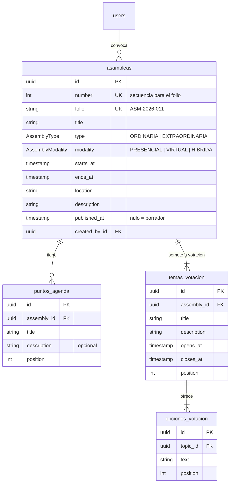
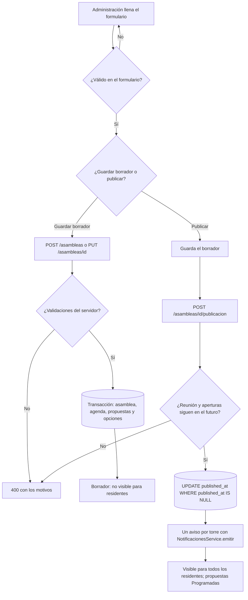
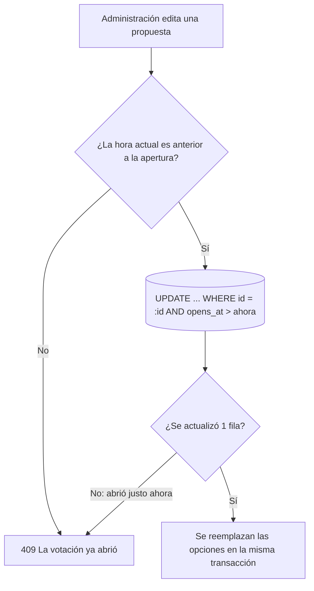
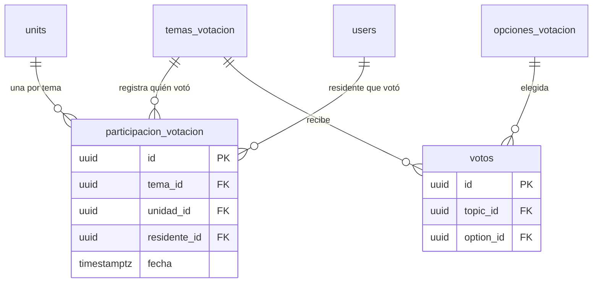
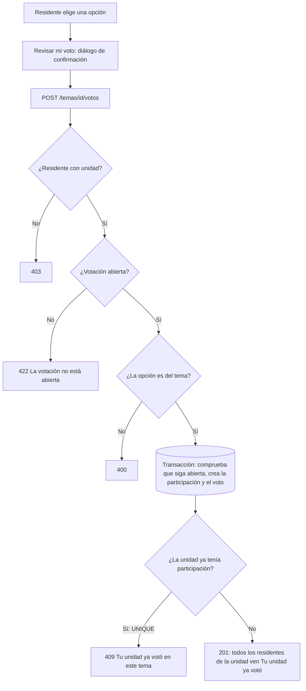

# Módulo 6: Asambleas y votaciones digitales

Responsable: Cristian Rodríguez · Historias implementadas: **H16. Convocar una asamblea con temas a votar** y **H17. Votar una sola vez por unidad** (sección 11).

Este documento describe el modelo de datos, los endpoints, los flujos, el frontend y las decisiones de arquitectura del módulo, con su justificación.

## Índice

1. [Alcance](#1-alcance)
2. [Modelo de datos](#2-modelo-de-datos)
3. [Estados](#3-estados)
4. [Endpoints](#4-endpoints)
5. [Flujos](#5-flujos)
6. [Frontend](#6-frontend)
7. [Decisiones de arquitectura](#7-decisiones-de-arquitectura)
8. [Pruebas](#8-pruebas)
9. [Datos de prueba](#9-datos-de-prueba)
10. [Pendientes y limitaciones conocidas](#10-pendientes-y-limitaciones-conocidas)

## 1. Alcance

La administración convoca asambleas con una agenda y una o más **propuestas a votar**, cada una con sus opciones y su plazo de votación. La convocatoria se prepara como borrador y, al publicarse, queda visible para todos los residentes y se les envía un aviso. El estado de cada votación (programada, abierta o cerrada) se calcula con la hora del servidor.

| Task | Descripción | Estado |
| --- | --- | --- |
| DB-16.1 | Tablas de asambleas, agenda, temas y opciones | Hecha |
| BE-16.1 | `POST /api/v1/asambleas` en una sola transacción | Hecha |
| BE-16.2 | Estado por hora del servidor y `PUT /api/v1/temas/{temaId}` con 409 | Hecha |
| BE-16.3 | `GET /api/v1/asambleas` y `GET /api/v1/asambleas/{id}` | Hecha |
| BE-16.4 | Aviso de convocatoria con `NotificacionesService.emitir()` | Hecha |
| BE-16.5 | Pruebas de integración | Hecha |
| FE-16.1 | Formulario de convocatoria | Hecha |
| FE-16.2 | Listado de asambleas del administrador | Hecha |
| QA-16.1 | Pruebas de aceptación | Ver [QA-16.1](qa/QA-16.1.md) |

### Relación entre el diseño y los criterios

El diseño de Jira muestra una sola "Propuesta a votar" con opciones fijas y un plazo por asamblea; el criterio de aceptación pide "al menos un tema", cada uno con dos o más opciones y su propio plazo. Se implementaron los dos: el formulario se ve como el diseño (una propuesta con "A favor / En contra / Abstención" ya cargadas), pero permite agregar más propuestas y editar o quitar opciones, cada propuesta con su plazo. En el modelo, **una propuesta es un tema de votación** (`temas_votacion`).

El diseño agrega elementos que no estaban en las tasks y que se incluyeron: tipo y modalidad de asamblea, lugar y hora de fin, agenda (puntos que no se votan), folio y **borradores**.

## 2. Modelo de datos



| Análisis | Prisma / tabla |
| --- | --- |
| `asamblea` (titulo, descripcion, fecha_hora, creada_por, fecha_creacion) | `Assembly` / `asambleas` (`title`, `description`, `startsAt`, `createdById`, `createdAt`) |
| `tema_votacion` (asamblea_id, titulo, descripcion, apertura, cierre) | `VotingTopic` / `temas_votacion` (`assemblyId`, `title`, `description`, `opensAt`, `closesAt`) |
| `opcion_votacion` (tema_id, texto) | `VotingOption` / `opciones_votacion` (`topicId`, `text`) |

### Reglas en la base de datos

| Regla | Cómo se implementa |
| --- | --- |
| El cierre de la votación es posterior a la apertura (DB-16.1) | `CHECK (closes_at > opens_at)` |
| La reunión termina después de empezar | `CHECK (ends_at > starts_at)` |
| Opciones sin repetir dentro de un tema | Índice único `(topic_id, text)` |
| Orden estable de agenda, temas y opciones | Índices únicos por `position` |
| Folio único | Índice único sobre `folio` |
| Agenda, temas y opciones pertenecen a su asamblea | Llaves foráneas con `ON DELETE CASCADE`; no existe ruta para borrar asambleas |

Migración: `20261116004826_db_16_1_asambleas`.

## 3. Estados

El estado no se guarda: se calcula en cada consulta (`src/asambleas/domain/assembly-status.ts`).

| Estado de una propuesta | Condición |
| --- | --- |
| `BORRADOR` (se muestra "No publicada") | La asamblea no tiene `published_at` |
| `PROGRAMADA` | Publicada y la hora actual es anterior a `opens_at` |
| `ABIERTA` | `opens_at` ≤ hora actual < `closes_at` |
| `CERRADA` | La hora actual es igual o posterior a `closes_at` |

El estado de la **asamblea** es `BORRADOR` si no está publicada; `ABIERTA` si alguna propuesta está abierta; `CERRADA` si todas cerraron; si no, `PROGRAMADA`.

## 4. Endpoints

Base: `/api/v1`. Todas las rutas requieren `Authorization: Bearer <token>`. Documentación interactiva en `/api/docs`.

| Método | Ruta | Rol | Respuestas |
| --- | --- | --- | --- |
| `GET` | `/asambleas` | Cualquiera (Administración ve también borradores) | 200, 400, 401 |
| `GET` | `/asambleas/audiencia` | Administración | 200, 401, 403 |
| `GET` | `/asambleas/{id}` | Cualquiera (borradores solo Administración) | 200, 400, 401, 404 |
| `POST` | `/asambleas` | Administración | 201, 400, 401, 403 |
| `PUT` | `/asambleas/{id}` | Administración | 200, 400, 401, 403, 404, 409 |
| `POST` | `/asambleas/{id}/publicacion` | Administración | 200, 400, 401, 403, 404, 409 |
| `PUT` | `/temas/{temaId}` | Administración | 200, 400, 401, 403, 404, 409 |

### `POST /asambleas`: crear la convocatoria (borrador)

```json
{
  "title": "Mejora del jardín central",
  "type": "EXTRAORDINARIA",
  "modality": "PRESENCIAL",
  "startsAt": "2026-11-18T19:00:00-06:00",
  "endsAt": "2026-11-18T20:30:00-06:00",
  "location": "Salón de eventos · Casa club",
  "description": "Convocamos a residentes a revisar la renovación del riego.",
  "agenda": [{ "title": "Estado actual del jardín", "description": "Zonas con riego irregular" }],
  "topics": [
    {
      "title": "Renovar el sistema de riego",
      "description": "Sustituir aspersores e instalar un programador.",
      "opensAt": "2026-11-18T20:30:00-06:00",
      "closesAt": "2026-11-21T20:00:00-06:00",
      "options": ["A favor", "En contra", "Abstención"]
    }
  ]
}
```

Guarda asamblea, agenda, temas y opciones **en una sola transacción** y responde 201 con el detalle en estado `BORRADOR`.

**400** con un mensaje por cada problema:
- Campos obligatorios vacíos o demasiado largos.
- Sin propuestas, o una propuesta con menos de 2 opciones.
- Reunión con fecha anterior a la actual, u hora de fin no posterior a la de inicio.
- Apertura de la votación anterior a la fecha actual.
- Cierre anterior o igual a la apertura.
- Opciones repetidas, sin distinguir mayúsculas.

Con varias propuestas, cada mensaje indica cuál ("Propuesta 2: …").

### `POST /asambleas/{id}/publicacion`

Vuelve a validar las fechas (la reunión y las aperturas no deben haber pasado), marca `published_at` solo si la asamblea sigue en borrador y envía el aviso. 409 si ya estaba publicada.

### `PUT /asambleas/{id}` y `PUT /temas/{temaId}`

- `PUT /asambleas/{id}` reemplaza **todo el borrador** (datos, agenda y propuestas). 409 si ya se publicó.
- `PUT /temas/{temaId}` modifica **una propuesta** (texto, opciones y plazo), en borrador o publicada, **mientras su votación no haya abierto**. 409 "La votación de esta propuesta ya abrió; no se puede modificar su texto ni sus opciones."

### `GET /asambleas`: listado

| Parámetro | Descripción |
| --- | --- |
| `q` | Título o folio |
| `estado` | `BORRADOR`, `PROGRAMADA`, `ABIERTA` o `CERRADA` |
| `desde`, `hasta` | Rango de fechas de reunión (`AAAA-MM-DD`, hora local del condominio) |
| `page` | Página (20 por página) |

Ordena por reunión más reciente primero. Devuelve `items` (resumen con estado, primer apertura y último cierre de votación, cantidad de puntos y propuestas), la paginación y `counts`: cantidad por estado con la búsqueda y el periodo aplicados, para los filtros del listado.

## 5. Flujos

### Convocar y publicar



### Editar una propuesta publicada



## 6. Frontend

| Ruta | Task | Contenido |
| --- | --- | --- |
| `/admin/asambleas/nueva` | FE-16.1 | Formulario de convocatoria con agenda y propuestas que se agregan y quitan; revisión en vivo, cantidad de residentes a avisar, guardar borrador y publicar con confirmación |
| `/admin/asambleas` | FE-16.2 | Listado con búsqueda, periodo, estado, conteo por estado, plazo de votación y acceso |
| `/admin/asambleas/{id}` | FE-16.2 | Detalle con agenda y propuestas; "Editar propuesta" solo en las programadas, con el motivo cuando ya abrió o cerró |
| `/admin/asambleas/{id}/editar` | FE-16.1 | Mismo formulario para continuar un borrador |

Todas las páginas revisan en el servidor que el usuario sea de Administración. El menú de administración agrega "Convocar asamblea" y "Asambleas".

**Formulario:**
- `react-hook-form` con `useFieldArray` para la agenda, las propuestas y las opciones de cada propuesta, y `zod` para las mismas reglas que valida el servidor.
- Las fechas se escriben en la hora local del condominio y se envían en ISO 8601 con el desfase `-06:00`, con `aIsoCondominio` de `lib/condominio.ts`.
- La agenda se reordena con botones de subir y bajar en lugar de arrastrar, porque es más simple y se puede usar con teclado.

**Estado:** igual que en el Módulo 5, sin librería de estado global: estado local por pantalla, y los datos entre pantallas viajan por la URL (`/admin/asambleas?publicada=ASM-2026-011` muestra el aviso de publicación).

La pantalla de asambleas **para residentes** (lista, detalle y voto) corresponde a H17 (FE-17.1 y FE-17.2). Desde H16 los residentes ya obtienen las asambleas publicadas por la API.

## 7. Decisiones de arquitectura

### 7.1 Estado calculado con la hora del servidor

Corresponde a la decisión 4 del análisis. Programada, Abierta y Cerrada salen de comparar la hora del servidor con `opens_at` y `closes_at`; no hay tareas programadas que puedan fallar o atrasarse, y el cambio de estado ocurre exactamente a la hora indicada. El cálculo está en funciones puras con sus propias pruebas unitarias.

### 7.2 Borradores separados de la publicación

`published_at` nulo significa borrador. Un borrador no lo ven los residentes, no genera aviso y se edita completo. Publicar es una acción aparte (`POST /asambleas/{id}/publicacion`) que vuelve a validar las fechas, porque entre guardar y publicar pudo pasar el momento de la reunión o de la apertura.

### 7.3 Edición bloqueada por una actualización condicional

`PUT /temas/{temaId}` actualiza con `WHERE opens_at > ahora`, dentro de una transacción que también reemplaza las opciones. Si la votación abre entre la consulta y la escritura, la base no actualiza nada y se responde 409; no hay una ventana en la que se pueda modificar una votación ya abierta. Lo mismo para el borrador: `WHERE published_at IS NULL`.

### 7.4 Apertura nunca en el pasado

Se rechaza una apertura (o reunión) anterior al minuto actual. Así los residentes siempre reciben el aviso antes de que abra la votación, que es el sentido de "saber con anticipación". Se compara contra el inicio del minuto porque el formulario trabaja con minutos: programar algo para "ahora mismo" no falla por segundos de diferencia.

### 7.5 Aviso a todas las unidades con el servicio del Módulo 9

Corresponde a la decisión 8 del análisis: el módulo no implementa su propio envío. `NotificacionesService.emitir()` acepta como destinatario un residente, una unidad o una torre (`GRUPO`), pero no "todos". Para avisar a todo el condominio sin cambiar el código del Módulo 9, **se emite un aviso por torre** (las torres salen de la tabla `units`); en conjunto cubren a los residentes activos de todas las unidades y se respetan sus preferencias del módulo "votaciones". El aviso enlaza a `/asambleas/{id}`.

Si el envío a una torre falla, la publicación **no se revierte**: la convocatoria ya es válida y el Módulo 9 tiene reintentos propios. El error queda registrado en el log.

### 7.6 Varias propuestas por asamblea

Se respeta el criterio ("al menos un tema", cada uno con sus opciones y su plazo) y el diseño (una propuesta con A favor / En contra / Abstención). Esto deja listo el modelo para H17 (un voto por unidad **en cada tema**) y H18 (resultados **por tema**).

### 7.7 Filtro por estado en memoria

El estado depende de la hora, así que no es una columna que se pueda filtrar en SQL. El listado trae las asambleas filtradas por texto y periodo, calcula el estado, cuenta por estado, filtra y pagina en memoria. Para la cantidad de asambleas de un condominio (decenas al año) es suficiente y mantiene una sola fuente de verdad para el estado.

## 8. Pruebas

```bash
npm test           # unitarias
npm run test:e2e   # integración, requiere Postgres levantado
```

| Tipo | Archivo | Qué cubre |
| --- | --- | --- |
| Unitarias | `src/asambleas/domain/assembly-status.spec.ts` | Borrador, Programada, Abierta y Cerrada en los instantes límite, y el estado de la asamblea |
| Unitarias | `src/asambleas/services/asambleas.service.spec.ts` | Folio, fecha pasada, apertura pasada, cierre no posterior, opciones repetidas, tolerancia del minuto actual, publicación con aviso por torre, aviso fallido sin revertir, doble publicación, borrador publicado, 409 al editar una propuesta abierta (también si abre durante la edición), 404, borradores ocultos y conteo por estado |
| Integración | `test/asambleas.e2e-spec.ts` | Borrador completo, validaciones (fecha pasada, menos de dos opciones, cierre no posterior, sin propuestas), roles, borrador oculto a residentes, publicación visible con aviso a todos los residentes, doble publicación, edición del borrador, audiencia, estados por hora, conteo y filtro por estado, edición de una propuesta programada, 409 con la votación abierta y control de roles |

Al cerrar H16 pasaban 105 pruebas unitarias y 52 de integración del proyecto.

## 9. Datos de prueba

`npm run db:seed` crea, si no existen, cinco asambleas con fechas relativas al momento de correrlo, convocadas por `admin@example.com` (contraseña `Demo1234!`):

| Asamblea | Estado al correr el seed |
| --- | --- |
| Señalización de estacionamiento | Cerrada |
| Renovación de luminarias | Cerrada |
| Mantenimiento de la casa club | Abierta |
| Reglamento de mascotas | Programada |
| Mejora del jardín central | Borrador |

## 10. Pendientes y limitaciones conocidas

| Tema | Detalle |
| --- | --- |
| Documento de apoyo (PDF) | Está en el diseño pero no en las tasks; se dejó para el final si hay tiempo. Reutilizaría la subida de archivos de incidencias |
| Resultados y auditoría | "Ver resultados" y la tarjeta de participación del diseño son de H18 |
| Notificar cambios | Editar una propuesta programada no envía un aviso nuevo a los residentes |
| Destinatario "todos" | Si el Módulo 9 agrega ese tipo, `notifyCommunity` puede hacer una sola llamada en lugar de una por torre |

## 11. H17. Votar una sola vez por unidad

| Task | Descripción | Estado |
| --- | --- | --- |
| DB-17.1 | `votos` (la participación usa `participacion_votacion` de DB-29.1) | Hecha |
| BE-17.1 | `POST /api/v1/temas/{temaId}/votos` | Hecha |
| BE-17.2 | "Tu unidad ya votó" en el detalle y el listado | Hecha |
| BE-17.3 | Pruebas de integración | Hecha |
| FE-17.1 | Asambleas del residente: lista y detalle | Hecha |
| FE-17.2 | Flujo de voto con confirmación | Hecha |
| QA-17.1 | Pruebas de aceptación | Ver [QA-17.1](qa/QA-17.1.md) |

### Modelo: voto secreto pero auditable



Corresponde a la decisión 5 del análisis:
- **`participacion_votacion`** dice **quién** votó y cuándo. La creó DB-29.1 (reporte de participación, Módulo 10) y el voto escribe en ella, así el reporte y la auditoría leen la misma fuente. Su restricción `UNIQUE (tema_id, unidad_id)` garantiza un voto por unidad aunque lleguen dos solicitudes al mismo tiempo, y es la base de la auditoría (H18).
- **`votos`** dice **qué** se votó, **sin unidad y sin fecha**. Si el voto guardara la hora, se podría cruzar con la hora de la participación y deducir qué eligió cada unidad.
- Las dos inserciones van en **una sola transacción**. Invariante verificable: la cantidad de votos de un tema es igual a la de participaciones.
- `votos` usa llaves foráneas con `RESTRICT`: un voto no desaparece al borrar su tema u opción.

Migración: `20261120120000_db_17_1_votos` (solo `votos`; `participacion_votacion` viene de `20261120042920_db_29_1_vw_participacion_votaciones`).

### `POST /api/v1/temas/{temaId}/votos`

Cuerpo: `{ "opcionId": "uuid" }`. Solo residentes.

| Código | Cuándo |
| --- | --- |
| 201 | Voto registrado. Responde `topicId`, `votedAt` y un mensaje; nunca la opción |
| 400 | La opción no pertenece al tema |
| 403 | El usuario no es residente o no tiene unidad (administración, seguridad) |
| 404 | El tema no existe o es de un borrador |
| 409 | "Tu unidad ya votó en este tema." |
| 422 | "La votación no está abierta: abre el …" o "… cerró el …" |

No existen rutas `PUT` ni `DELETE` de votos: un voto no se cambia ni se elimina.

`GET /asambleas/{id}` agrega en cada tema `unitVote` (`{ votedAt }` si la unidad del residente ya votó, sin la opción) y `GET /asambleas` agrega `pendingVotesForUnit` (votaciones abiertas en las que la unidad aún no vota). Para quien no es residente con unidad, ambos valen `null`.

### Flujo del voto



### Frontend

| Ruta | Task | Contenido |
| --- | --- | --- |
| `/asambleas` | FE-17.1 | Listado de asambleas publicadas con aviso de votación pendiente para la unidad, pestañas Todas / Abiertas / Próximas / Cerradas y búsqueda |
| `/asambleas/{id}` | FE-17.1 y FE-17.2 | Convocatoria, agenda, propuesta, plazo y "Tu voto": opciones, diálogo de confirmación, botón deshabilitado durante el envío, mensajes de 409 y 422 y "Tu unidad ya votó" |

`/asambleas/{id}` es el destino del enlace del aviso de convocatoria (H16). Administración y Seguridad pueden consultar las asambleas, pero **no ven la opción de votar**.

### Decisiones

- **La unicidad la garantiza la base, no el código.** Revisar primero si la unidad ya votó y después insertar tiene una carrera entre la lectura y la escritura. Con `UNIQUE (tema, unidad)`, dos solicitudes simultáneas no pueden crear dos participaciones; la segunda recibe 409. Hay una prueba que lo comprueba en paralelo.
- **La transacción vuelve a comprobar el plazo**, así un voto que llega en el instante del cierre se rechaza aunque la validación previa lo haya dejado pasar.
- **"Tu unidad ya votó" sin la opción.** Ni siquiera a la propia unidad se le muestra qué eligió: la base no puede relacionar el voto con la unidad.

### Pruebas

| Tipo | Archivo | Qué cubre |
| --- | --- | --- |
| Unitarias | `src/asambleas/services/votos.service.spec.ts` | Voto válido, 403 para administración y residente sin unidad, 422 programada y cerrada, 400 opción ajena, 404 tema inexistente o borrador, 409 y cierre durante la transacción |
| Integración | `test/votos.e2e-spec.ts` | Voto válido visible para toda la unidad, segundo voto (409), solicitudes simultáneas, fuera del periodo (422), opción de otro tema (400), sin unidad (403), borrador (404), sin rutas PUT ni DELETE, tabla `votos` sin unidad y votos igual a participaciones |

Al cerrar H17 pasaban 283 pruebas unitarias y 98 de integración del proyecto.
